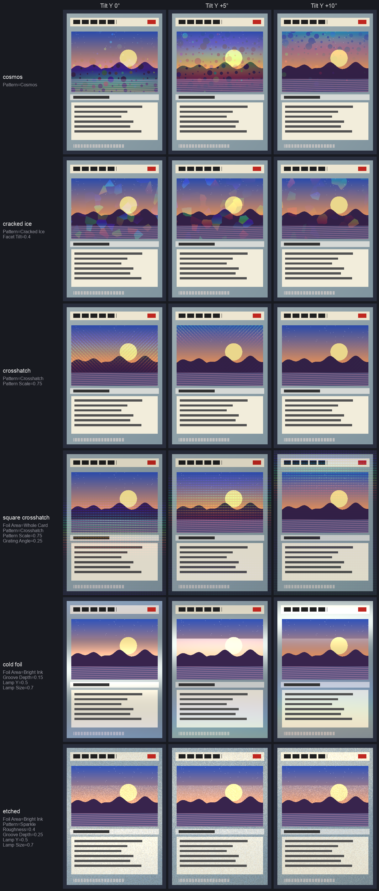

# holofoil

> **AI-assisted project.** This codebase was created with [Claude](https://claude.com/claude-code) (Anthropic), directed and reviewed by a human author. Its behaviour is measured rather than asserted. An offline harness drives the plugin's own class in a headless GL context and checks each claim against an independent model.
>
> - **Colour:** every pixel's light matches a wavelength-by-wavelength sum of the grating equation through the CIE colour matching functions, within 0.33 % of the brightest. Its dominant wavelength is the grating's, within 0.83 of a bound derived for it.
> - **Areas and passthrough:** a reverse holo is the exact complement of a holo. At zero Mix the clip comes through bit for bit.
> - **The checks can fail:** 17 negative controls and 29 one-character mutants show it.
>
> It has **never been loaded into Resolume**; a stand-in host has loaded it, as Status below says. It is **unreleased**. Full details are under [Status](#status).

Trading-card foil, as an FFGL effect for [Resolume](https://resolume.com) Arena and Avenue. Put the foil in the art window (a holo), around it (a reverse holo) or over the whole card. Emboss it plain, crosshatched, with discs, in shards or as glitter. Then tip the card under a lamp. The colour comes from a diffraction grating: each wavelength leaves the foil at its own angle, so the rainbow sweeps as the card moves.


<sub>Rendered by `hftest`, the offline harness, not captured from Resolume. The harness's own card, the art frozen, under the default strip lamp. `tools/figures.py` makes these.</sub>



[`docs/tip.mp4`](docs/tip.mp4) shows one cycle of the default motion: the card tipping toward and away, 12° each way, every 5 s. It plays holo, reverse holo, cracked ice and sparkle side by side.

## The one idea

**Holographic foil is a reflection grating: aluminium embossed with ridges about a micron apart.** Light of wavelength λ leaves it in order *m* only where the part of (v + l) in the surface is *m*λ/*d* along the grating's direction *g*:

    (v + l)∥ = (m λ / d) g          v: toward the eye, l: toward the lamp, d: the pitch

That is the grating equation. So a pixel's hue is λ = *d* (v + l)·g / *m*, and holofoil computes it per pixel in linear light. The lamp is not a point: it is a Gaussian in direction, round or a long strip. Each pixel therefore sees a spectral line with a centre and a width, read from a table of the colours of such lines through the CIE 1931 matching functions. Order 0 is the mirror, and the grooves take some of each wavelength from it (Raman–Nath: J₀²).

The pattern sets the grating region by region: its direction, its pitch and the lean of its surface. Everything else falls out:

- **Bands sweep as the card tips**, across the lines and in spectral order.
- **A big or rough lamp washes the colour toward silver.** Roughness is exactly a bigger, dimmer lamp.
- **The mirror is tinted by the groove depth.** The default 130 nm leaves it warm. At 210 nm it is magenta, with green gone.
- **A near lamp or eye spreads a rainbow across a still card.**
- **Ink is a filter.** Light print shows the foil and dark print kills it.
- **Cell patterns flash rather than sweep.** In cosmos, cracked ice and sparkle every cell has its own grating, so the cells light one at a time.
- **A plain grating under a round lamp is only a streak.** That is why the default lamp is a strip light and the default motion tips the card toward and away (Tip) rather than rocking it.

## Finishes

| finish | Foil Area | Pattern | and |
|---|---|---|---|
| holo | Art Window | Rainbow | (the default) |
| reverse holo | Around Art | Rainbow | |
| full foil | Whole Card | Rainbow | |
| shiny (sparkle) | Whole Card | Sparkle | Facet Tilt and Roughness up |
| cosmos | Art Window | Cosmos | |
| cracked ice | Art Window | Cracked Ice | Facet Tilt 6–10° |
| diagonal crosshatch | Art Window | Crosshatch | |
| square crosshatch | Whole Card | Crosshatch | Grating Angle 45° |
| cold foil | Bright Ink | Rainbow | Groove Depth ~60 nm: mostly mirror, registered to the print's light areas |
| etched | Bright Ink | Sparkle | Roughness 4°, Groove Depth ~100 nm |

Rainbow foil and cold foil differ mainly in Groove Depth. Around 130–160 nm most of the light goes into the colours; below about 80 nm most of it stays in the mirror.

## Controls

- **Finish**
  - **Foil Area**: Art Window, Around Art, Whole Card, Bright Ink, Dark Ink or Clip Alpha.
  - **Pattern**: Rainbow, Crosshatch, Cosmos, Cracked Ice or Sparkle.
- **Card**
  - **Tilt X** and **Tilt Y**: ±40°.
  - **Motion**: Hold, Tip, Swing, Circle or Lamp Orbit.
  - **Motion Depth**: 0–40°.
  - **Motion Rate**: 0.02–4 a second, beat or bar.
  - **Motion Sync**: Free, Beat or Bar.
  - **Viewer Distance**: 0.6 picture widths to infinity.
- **Lamp**
  - **Lamp X** and **Lamp Y**: ±80°.
  - **Lamp Distance**: 0.4 widths to infinity.
  - **Lamp Size**: 0.2–20°.
  - **Lamp Length**: 1 (round) to 20 (a strip across the room).
  - **Lamp Brightness**.
- **Foil**
  - **Pitch**: 500–3000 nm.
  - **Grating Angle**.
  - **Groove Depth**: 0–400 nm.
  - **Pattern Scale**.
  - **Facet Tilt**: up to 20°.
  - **Roughness**: up to 10°.
- **Print**
  - **Ink**: how much the print filters the foil.
  - **Base**: how much of the paper's white the foil replaces under ink.
- **Area**
  - **Window X**, **Window Y**, **Window Width**, **Window Height**, **Corner** and **Softness**.
  - **Threshold**, for the ink areas.
- **Output**
  - **Mix**.

Every control is smooth to automate. An LFO on Tilt or Lamp X never steps; `--smooth` checks that. Lamp Orbit holds the card still and moves the lamp round it, so the colours follow the light.

The defaults:

- **Motion:** the card tipping gently toward and away (Tip, 12°, 0.2 Hz) at arm's length (2.5 widths).
- **Lamp:** a strip light 35° up, three widths off, 2° wide and 8 times as long.
- **Foil:** a 900 nm grating, 130 nm deep, with its lines running across the card.

## Status

**v0.1.0, local and unreleased** (2026-11-02). There is no GitHub repo, release, website entry or user guide. Releasing needs Allan's go-ahead.

### Measured offline, on macOS

`tools/verify.sh` passes on this machine (Apple M4 Max, macOS 26) against a fresh universal Release build. It runs every picture check at **two rasters**, 630×882 (a card) and 320×180, and again on **Apple's software renderer** at 320×180.

The harness's reference never uses the plugin's table, its spectral lines or its along/across algebra. It computes the light wavelength by wavelength, in double, in a card frame built from rotation matrices.

| check | result |
| --- | --- |
| `--grating` | Five scenes: a far lamp overhead, a turned card, a near lamp, the second order alone, and the defaults' strip lamp with roughness. Each pixel's light against the per-wavelength sum is worst **2.4e-3** of the brightest (bound 1e-2). Its dominant wavelength against *d*·\|s·g\|/*m* over 470–600 nm is worst **0.83** of a bound that grows with the line's width. |
| `--mirror` | With no groove, the highlight is at the mirror point (L_z E + E_z L)/(E_z + L_z) for near and far eyes and lamps on a turned card: worst **0.001 px** (bound 0.01). |
| `--groove` | The mirror's colour against J₀² through the matching functions, at six depths from 0 to 400 nm: worst **5.7e-6**. It is white at 0 nm and magenta at 210 nm. |
| `--lamp` | Purity falls as the lamp grows from 1° to 16°. Roughness *r* matches a lamp √(1 + (h_z r)²)° wide, dimmer by the ratio of the areas, to **3.0e-7**. The absolute light matches the spectrum to **2.2e-3**. |
| `--patterns` | Each pattern, read out of the shipped shader, embosses what it says: the crosshatch splits 0.50 / 0.50 / 0.25, cosmos discs cover 17–19 %, and shard and glitter directions are uniform. Every pixel's light is the spectrum's for the grating there, to **3.3e-3**. |
| `--complement` | Art Window + Around Art, and Bright Ink + Dark Ink, sum in linear light to the clip plus the whole card's foil, to **3.7e-7**. Where one is the clip, the other is the whole foil, bit for bit on the GPU. Apple's software renderer does not repeat a draw bit for bit, so there the bound is 2e-5. |
| `--window` | Coverage against an exact per-pixel integral: straight edges **1.5e-5**, rounded corners within their derived bound. Whole pixels are bit-exact on the GPU; outside the window they are bit-exact everywhere. |
| `--luma` | The ink areas key on Rec. 709 luminance in *linear* light, encoded back: **1.1e-6**. |
| `--ink` | foil = C (1 − Ink + Ink·Base) + sheen (1 − Ink + Ink·C), in light, and Mix fades in light: **4.9e-7** over five prints. |
| `--passthrough` | Mix 0, and every pixel outside the area, gives back the clip **bit for bit**, for every area and pattern, and alpha never moves. |
| `--smooth` | Halving Tilt's step halves the largest frame-to-frame change (ratio **1.95**). |
| `--clock` | A host clock 499,217,238 ms in renders the same take as one starting at 0 s, in Free, Beat and Bar. |
| `--state` | The host's GL state comes back in all six areas, across a resize and a rebuild of the colour table. |
| `--motion`, `--controls`, `--cues`, `--names` | No GL needed: the motion's phase and shapes, every slider's ends and middle against the numbers above, cue sheets, and 33 parameter names. |
| `--negative` | **17** deliberately wrong models, **17** caught. |
| `tools/mutate.sh` | **29** one-character mutants (21 in the GLSL), **29** caught. |
| `tools/sweep.py` | All **31** controls change the picture. |
| shaders | All 3 compile through `glslc`, not only through Apple's driver. |
| the bundle | Universal (`x86_64 arm64`), exports `plugMain` and ad-hoc signs. `oxbow`, a stand-in host, reads `SW Holofoil` / `HF01` / `effect` with 33 parameters and renders 120 frames through `plugMain`. |

### Cost

GPU time per frame on an M4 Max at 4K:

- defaults: **0.53 ms**
- Cracked Ice over the whole card: 0.81 ms
- Cosmos: 1.12 ms
- Groove Depth automated, which rebuilds the colour table every frame: 1.04 ms

At 1080p every pattern is under 0.3 ms, and automating Groove Depth costs 0.57 ms.

### Not established

- **Never loaded into Resolume** on either platform. No Windows build has been made.
- Not yet **seen by eye** beside a real foil card. The measurements show the plugin does what the optics say; they do not show the optics are the right ones for a given card. Finish pitches and groove depths are typical values for embossed holograms, not measured from any trading card.
- **Patterns are point-sampled.** A crosshatch at its natural scale is about 8 px a period at 720 wide and aliases on smaller rasters. Raise Pattern Scale there.
- **Light comes from one lamp, with no room around it.** A mostly-mirror foil, such as cold foil, shows nothing away from the lamp's reflection.

## Build

macOS, universal (Apple Silicon and Intel):

```bash
cmake -B build -DCMAKE_BUILD_TYPE=Release
```

```bash
cmake --build build
```

```bash
cmake --install build
```

The last one copies `Holofoil.bundle` into `~/Documents/Resolume Arena/Extra Effects`. Restart Arena and it's under Effects as **SW Holofoil**.

## Building and testing

```bash
tools/verify.sh
```

That runs everything:

- a fresh universal build
- every check at two rasters and on the software renderer
- the negative controls and the mutants
- the sweep for dead controls
- the bundle's architecture and plist, and an ad-hoc signature
- a host's view of the bundle through `oxbow` (set `OXBOW=` to its binary)
- the render cost

`CLAUDE.md` lists the checks one by one.

Render a frame of your own:

```bash
./build/hftest --out /tmp/holofoil.png --set "Pattern=Cracked Ice" --set "Foil Area=Around Art"
```

## License

MIT. See [LICENSE](LICENSE) and [ATTRIBUTIONS.md](ATTRIBUTIONS.md).
