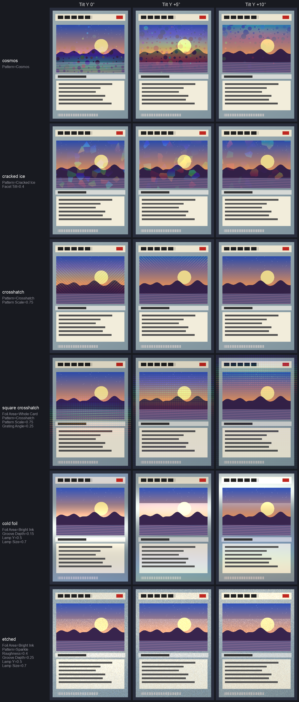

# Holofoil user guide

Holofoil is **holographic trading-card foil for [Resolume](https://resolume.com) Arena and
Avenue**: one FFGL effect, **SW Holofoil**, that treats your clip as the print on a card and puts
a foil under it. The holo window behind the art, the reverse holo round it, foil over the whole
card, or foil only where the print is light or dark. Emboss it plain, crosshatched, with discs, in
shards or as glitter, then tip the card under a lamp and watch the rainbow go across it.

None of the colour is painted on. Holographic foil is aluminium pressed with ridges about a micron
apart, and ridges that fine make a diffraction grating, which sends each wavelength of the lamp's
light off at its own angle. So the colour at any point depends on where the lamp is, where your eye
is and which way the card is tipped. The plugin works that out for every pixel, through the grating
equation and the colour matching functions your eyes come with, and adds the light to the print the
way light adds.


*Rendered by `hftest`, the offline harness, rather than captured from Resolume: the harness's own
test card with the art frozen, under the default strip lamp, at 360×504. Each row is one finish,
each column a tilt. [`tip.mp4`](https://github.com/stoatworks-labs/holofoil/blob/main/docs/tip.mp4)
shows the default motion on four of them.*

> **Before you rely on this:** it's at **v0.1.0**, the first release, and very early days. Its
> behaviour is measured rather than asserted, by a harness (`hftest`) that drives the plugin's own
> shader in a headless GL context on one Apple Silicon Mac (macOS 26), at 630×882 and 320×180 and
> again on Apple's software renderer. Every pixel's light is within 0.18 % of the brightest of a
> wavelength-by-wavelength sum of the grating equation that shares none of the plugin's shortcuts,
> and its colour is the wavelength the grating says, within a bound worked out for it. The mirror
> highlight lands within a thousandth of a pixel of where geometry puts it. A holo and a reverse
> holo add up to the clip plus a whole-card foil to within four parts in ten million, and at zero
> Mix the clip comes through bit for bit. Seventeen models that are wrong on purpose and 29
> one-character changes to the shipped code are all caught, and all 31 controls measurably change
> the picture.
> It's **never been loaded into Resolume on macOS**. The one host it has run in on a Mac is the
> fleet's own test host, `oxbow`, for 120 frames.
> On Windows it **has been in Resolume**: the release workflow's own build, in Resolume Arena
> 7.27.1 on a test machine with no GPU (software rendering), twice. It registers, all 36 of its
> parameters arrive as declared, it renders, Arena's log stays clean, and every control that can act
> on a still picture changed Arena's picture. The three that set how the card moves over time
> (Motion Depth, Motion Rate and Motion Sync) can't be judged on a still.
> Nobody has held it up next to a real foil card yet. Try it on a spare layer before you put it in
> a show.
>
> This codebase was created with AI assistance, directed and reviewed by a human author.

---

## Installing

Every download carries one effect, **SW Holofoil** (`Holofoil.bundle` on macOS, `Holofoil.dll` on
Windows). Drop it into Resolume's effects folder and restart Resolume:

```
macOS    ~/Documents/Resolume Arena/Extra Effects/
Windows  %USERPROFILE%\Documents\Resolume Arena\Extra Effects\
```

Avenue uses the same layout under its own folder name. The effect then shows up in the effects
browser as **SW Holofoil**.

The macOS download is a universal build (Apple silicon and Intel), as a `.dmg` or a `.zip`. It's
**Developer ID-signed and notarised** by the release pipeline after publication, so the bundle
just loads. If macOS refuses a download, it's from before the signing, so download it again. The
Windows download is an x64 installer or a `.zip`. The installer is for you alone, so it asks for
no administrator password, and it starts on Arena's Extra Effects folder (Avenue's, if only Avenue
is there); its folder page names both, if you want the other. `Holofoil.dll` goes in that folder,
and its README, notices and uninstaller in a `Holofoil` folder beside it, where Resolume pays them
no attention. Quit Resolume first. It isn't code-signed, so it trips SmartScreen once: **More
info** → **Run anyway**. Or skip the installer, take `Holofoil.dll` out of the `.zip` and drop it
into the folder by hand.

---

## Start here

1. Put **SW Holofoil** on a clip. A card-shaped one is best (portrait, art at the top, a text box
   below), but anything works: the plugin doesn't look for a card, it assumes one.
2. Out of the box it's a holo. The foil sits in a window over the top half of the frame, the card
   rocks gently toward you and away every five seconds, and a band of rainbow climbs through the
   window as it does.
3. Change **Foil Area** to **Around Art** for a reverse holo, or **Whole Card** for the lot.
4. Change **Pattern** to **Cracked Ice** or **Sparkle**. The colour stops sweeping and starts
   flashing, cell by cell.
5. Set **Motion** to **Hold** and drag **Tilt Y** yourself. That's the card in your hand.

If you see the clip and no colour at all, the lamp's reflection is missing the window: give it a
moment for the card to tip round, or see [If it looks wrong](#if-it-looks-wrong).

---

## How the colour is made

A grating's colour obeys one equation. Take the direction to your eye and the direction to the
lamp, add them, and look at the part of that sum lying in the card's surface. Light of wavelength
λ leaves the foil only where that part is a whole number of λ/d along the grating, where d is the
spacing of the ridges. So a pixel's colour is λ = d × (that part) / m, with m the order: 1 for the
first rainbow, 2 for the second, fainter and twice as spread out. Order 0 is the mirror, where the
foil reflects the lamp like any shiny surface.

Most of what you'll see falls out of that:

- **Bands sweep as the card tips**, across the grating's lines and in spectral order. Tip it the
  other way, along the lines, and the colour barely moves.
- **A big lamp washes the colour toward silver.** A point lamp gives each pixel one wavelength; a
  wide one gives it a band of them, and a wide enough band is white. That's why foil looks best
  under spotlights and dull under an overcast sky.
- **A near lamp or a near eye spreads a rainbow across a still card**, because each part of the
  card sees the lamp from a different angle.
- **Ink is a filter.** Light print lets the foil's light through and dark print stops it.
- **Cell patterns flash rather than sweep.** In Cosmos, Cracked Ice and Sparkle every cell has its
  own grating, pointing its own way, so the cells light one at a time.
- **A plain grating under a small round lamp is one thin streak.** That's physically correct and,
  as a light show, a bit of a let-down, which is why the default lamp is a strip light.

The colour of each wavelength comes from the CIE 1931 colour matching functions, and the share of
the light that goes into each order from the depth of the grooves. Everything is worked out in
linear light, then encoded for the screen.

---

## The Finish group

### Foil Area

Where the foil is.

| Foil Area | what it is |
|---|---|
| **Art Window** | the holo: foil behind the picture, in a window set by the Area group |
| **Around Art** | the reverse holo: foil everywhere except the window, its exact complement |
| **Whole Card** | foil everywhere |
| **Bright Ink** | foil only where the print is lighter than **Threshold** |
| **Dark Ink** | foil only where it's darker, the exact complement of Bright Ink |
| **Clip Alpha** | foil where the clip is opaque, following its own alpha |

Bright Ink is how cold foil and etched cards are printed, with the foil registered to the light
parts of the art. Clip Alpha lets you draw the foil area yourself, with a clip that has an alpha
channel.

### Pattern

What's pressed into the foil.

| Pattern | what it is |
|---|---|
| **Rainbow** | one grating across the card. The classic holo sweep. |
| **Crosshatch** | two families of diagonal lines, each its own grating, so two bands cross |
| **Cosmos** | discs of every size, each its own grating, on a plain one |
| **Cracked Ice** | shards, each its own grating and slightly tilted |
| **Sparkle** | tiny tilted facets, each a grating: glitter |

The cell patterns are the same on every GPU and every run (each cell's grating comes from a hash
of where it is, not from a random number).

---

## The Card group

**Tilt X** and **Tilt Y** turn the card, ±40° each way; the middle is square on. Tilt Y tips the
top toward or away from you, Tilt X turns it side to side.

**Motion** moves the card for you:

| Motion | what it does |
|---|---|
| **Hold** | nothing: the card stays where Tilt X and Tilt Y put it |
| **Tip** | toward you and away, round Tilt Y. The default, and what sweeps a grating's colour under a lamp overhead |
| **Swing** | side to side, round Tilt X |
| **Circle** | the tilt goes round a circle, centred on Tilt X and Tilt Y |
| **Lamp Orbit** | the card holds still and the lamp goes round its place, so the colours follow the light |

**Motion Depth** is how far it goes, 0 to 40° (12° by default). **Motion Rate** is how fast, 0.02
to 4 cycles, counted in seconds, beats or bars according to **Motion Sync**: **Free**, **Beat** or
**Bar**. The default is a cycle every 5 seconds.

**Viewer Distance** is how far your eye is from the card, in card widths: 0.6 at the bottom to
infinitely far at the top, 2.5 by default. Close in, each part of the card sees you from a
different angle, so the colour spreads across it.

---

## The Lamp group

**Lamp X** and **Lamp Y** are where the lamp is, seen from the middle of the card: ±80° across and
up. The default is straight ahead and 35° up.

**Lamp Distance** is in card widths, from 0.4 to infinitely far (3 by default). A near lamp
spreads the colour the way a near eye does.

**Lamp Size** is how big the lamp looks from the card, 0.2° to 20° (2° by default). Small is a
bare bulb and pure colour; large is a softbox and silver.

**Lamp Length** stretches the lamp into a strip light, from 1 (round) to 20 times as long as it is
wide (8 by default). The strip runs across the room, level, so a grating with its lines running
across too catches it all along them and gives a broad band instead of a thin streak.

**Lamp Brightness** runs from 0 to 4, where 1 is as bright as the paper's white (1.5 by default).
Foil is far brighter than paper where it catches a lamp, which is rather the point of it.

---

## The Foil group

**Pitch** is the spacing of the ridges, 500 to 3000 nm (900 by default). Finer ridges throw the
colours further apart, so the rainbow sweeps faster as the card tips. Coarser ones crowd the
orders together.

**Grating Angle** turns the grating, 0 to 180°. The default, 90°, runs the lines across the card,
so tipping it toward you sweeps the colour; turn them to run up the card and it's Swing that does.

**Groove Depth** is how deep the ridges are, 0 to 400 nm (130 by default). It decides how much of
the light goes into the colours and how much stays in the mirror. Around 130 to 160 nm most of it
goes into the colours; below about 80 nm most of it stays in the mirror, and that's a cold, mostly
silver foil. At 0 the foil is a plain mirror. The mirror's own colour changes with depth too: warm
at the default, magenta around 210 nm, where the green has all gone into the rainbow.

**Pattern Scale** sizes the cells of Cosmos, Cracked Ice and Sparkle, a quarter to four times their
natural size. At 720p and below the smallest cells can shimmer; give them more room.

**Facet Tilt** is the most a cell's surface leans, 0 to 20° (6° by default). Each cell catches the
lamp at a different moment, which is what makes Cracked Ice and Sparkle flash.

**Roughness** blurs the surface's direction under each pixel, 0 to 10°. It's exactly a bigger,
dimmer lamp, so it takes the colour toward silver: a few degrees is the etched or brushed look.

---

## The Print group

The clip is the ink on the card, and ink sits on top of the foil.

**Ink** is how much the print filters the foil, 0 to 1 (0.6 by default). At 0 the foil's light is
simply added over the clip. At 1 the print is a proper filter: the foil shows through light ink at
full strength, takes the ink's colour through coloured ink, and doesn't get through black at all.

**Base** is how much of the paper's white the foil replaces under the print, 0 to 1 (0.7 by
default). Foil away from its highlight is darker than white card, so with Base up the print looks
like it's on foil rather than paper. It only acts where Ink does.

---

## The Area group

**Window X**, **Window Y**, **Window Width** and **Window Height** place the art window, in
fractions of the frame: by default it's centred across, a little above the middle, 84 % of the
width and 42 % of the height, which is where the art sits on a trading card. **Corner** rounds its
corners, up to a quarter of the frame's height, and **Softness** feathers its edge, up to a tenth.
Around Art uses the same window, inside out.

**Threshold** is where Bright Ink and Dark Ink split, on the print's luminance (Rec. 709 weights,
in linear light). With an ink area, **Softness** ramps the foil in either side of the threshold
rather than feathering the window.

---

## The Output group

**Mix** fades the effect in, in linear light, so halfway is half the foil's light rather than a
murky crossfade. At 0 the clip comes through untouched, bit for bit.

---

## Recipes



*Rendered by `hftest`, as above. Pattern Scale is 0.75 throughout, so the cells don't alias at this
size, and the cold foil and etched rows use Lamp Y 0.5 and Lamp Size 0.7, so their mirror catches
the lamp.*

| finish | Foil Area | Pattern | and |
|---|---|---|---|
| holo | Art Window | Rainbow | the defaults |
| reverse holo | Around Art | Rainbow | |
| full foil | Whole Card | Rainbow | |
| shiny (glitter) | Whole Card | Sparkle | Facet Tilt and Roughness up a bit |
| cosmos | Art Window | Cosmos | |
| cracked ice | Art Window | Cracked Ice | Facet Tilt 6–10° |
| diagonal crosshatch | Art Window | Crosshatch | |
| square crosshatch | Whole Card | Crosshatch | Grating Angle 45° |
| cold foil | Bright Ink | Rainbow | Groove Depth about 60 nm |
| etched | Bright Ink | Sparkle | Roughness 4°, Groove Depth about 100 nm |

A few more:

- **Under a moving head.** Motion **Hold**, Foil Area **Whole Card**, and put an LFO or a fader on
  **Lamp X**. The colour follows the light across the card.
- **The light goes round.** Motion **Lamp Orbit** with Motion Sync **Bar**: the card stays put and
  the lamp circles once a bar.
- **Spectrum on the beat.** Motion **Tip**, Motion Sync **Beat**, Motion Rate at one cycle a beat.
- **A foil logo.** A logo clip with alpha in front of a picture, Foil Area **Clip Alpha** on the
  logo's layer.

---

## Time and tempo

Motion runs on its own clock or on Resolume's. With Motion Sync on **Beat** or **Bar**, Motion
Rate counts cycles per beat or per bar of Resolume's tempo, and the pace follows the tempo when it
changes. It keeps the pace rather than locking to the downbeat, so a cycle starts wherever the card
happens to be. The motion moves on from where it was each frame, so changing Motion Rate, Motion
Sync or the tempo changes the pace without the card jumping, and every slider can be automated
without the picture stepping.

---

## Performance

Measured on an Apple M4 Max with the plugin's own bench (`hftest --bench`), GPU time a frame:

| | 720p | 1080p | 4K |
|---|---|---|---|
| the defaults (Art Window, Rainbow) | 0.09 ms | 0.21 ms | 0.52 ms |
| Whole Card, Cracked Ice | 0.07 ms | 0.21 ms | 0.80 ms |
| Whole Card, Cosmos | 0.10 ms | 0.28 ms | 1.13 ms |
| Groove Depth automated | 0.50 ms | 0.58 ms | 1.05 ms |

Cosmos is the dearest pattern. Changing **Groove Depth** rebuilds the colour table (2048 × 129
entries), so automating it costs about half a millisecond more a frame, whatever the size; leave it
still if you're short of time. Nothing here has been timed on Windows,
or on a GPU smaller than this one.

---

## If it looks wrong

**The clip and no colour.** The lamp's reflection is missing the foil. Wait for Motion to tip the
card round, or tip it yourself, or move **Lamp Y**. Check **Lamp Brightness** isn't at 0, **Mix**
isn't at 0, and with **Bright Ink** that the clip has some light in it.

**Everything's silver.** The lamp is too big, or the foil too rough, or the grooves too shallow.
Bring down **Lamp Size** or **Roughness**, or push **Groove Depth** back toward 130 nm.

**One thin streak.** That's a plain grating under a small round lamp, which is accurate. Turn up
**Lamp Length**, or use a cell pattern.

**The colour doesn't move when the card tips.** You're tipping along the grating's lines. Use
**Swing** instead of **Tip**, or turn **Grating Angle** by 90°.

**The pattern shimmers or crawls.** The cells are smaller than a few pixels. Turn up **Pattern
Scale**. The pattern edges aren't anti-aliased.

**The window's in the wrong place.** It's set in fractions of the frame by the Area group, not
found from the clip. A landscape clip puts it across the middle of the frame.

**Clip Alpha covers everything.** The clip has no alpha, so it's opaque everywhere.

**The print looks dim.** That's **Base**: the foil replaces some of the paper's white under the
print. Turn it down, or turn **Ink** down.

---

## Known limits

- **It's one card's worth of optics, not all of them.** Not modelled: thin-film iridescence,
  polarisation, a rigorous grating efficiency (it uses the thin-grating approximation), the exact
  reflectance curve of aluminium, orders past the second, light from the room other than the one
  lamp, glare and bloom, raised or embossed foil from the clip's own picture, and dot-matrix
  holograms with their own artwork.
- **One lamp.** Away from the highlight a mirror foil reflects nothing at all, where a real one
  would show the room. A second large, dim lamp would fix it; there isn't one yet.
- **The card is flat** and the frame is the card, so the art window is fixed in the frame rather
  than found in the clip.
- **No presets.** The recipes above are the nearest thing. The
  [browser demo](https://holofoil-demo.stoatworks-labs.com/) has them in its Presets menu, to try
  before installing: the plugin's own shaders with every control, but a browser, not Resolume,
  and it says what it leaves out.
- **Never loaded into Resolume on macOS**, and not compared against a real foil card.

---

## About

The last group, **About**, has the plugin's name, version, licence and maker, and buttons that open
this user guide, the project page, the source on GitHub and the support page in your browser.

## Reporting something

If something's wrong, shout at
[github.com/stoatworks-labs/holofoil/issues](https://github.com/stoatworks-labs/holofoil/issues). A
screenshot, the controls you changed, and the composition's resolution are usually enough. If the
effect drew nothing, attach the log:

```
macOS    ~/Library/Logs/holofoil/holofoil.YYYY-MM-DD.log
Windows  %LOCALAPPDATA%\holofoil\logs\holofoil.YYYY-MM-DD.log
```

The FFGL SDK and GLEW the plugin is built on, and the published work it's checked against, are
credited in [ATTRIBUTIONS.md](https://github.com/stoatworks-labs/holofoil/blob/main/ATTRIBUTIONS.md),
which travels with the plugin.
